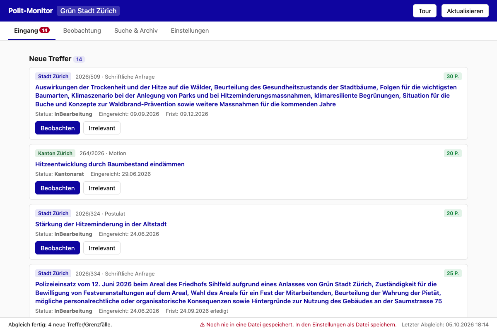
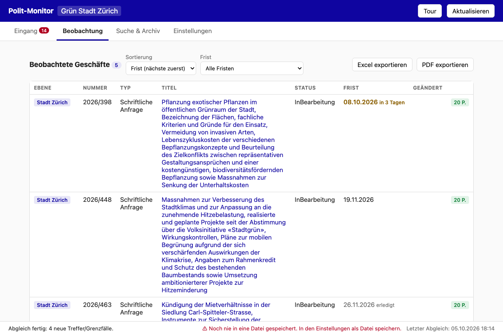
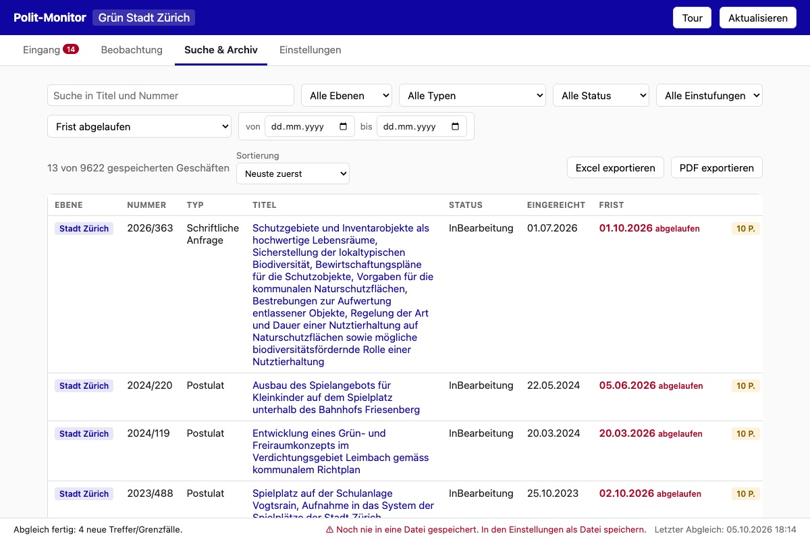
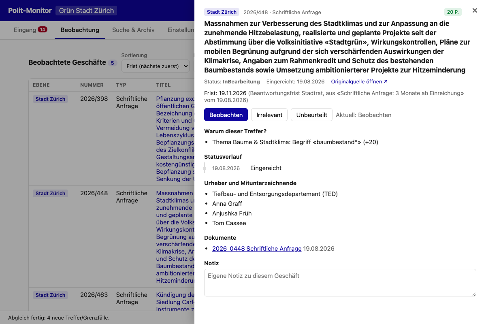
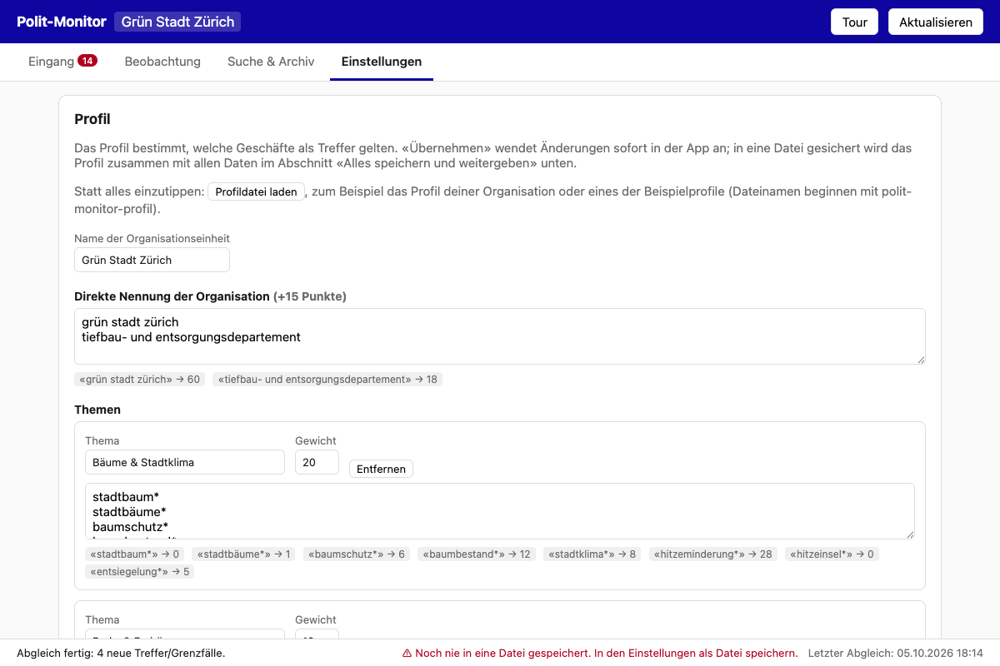

# Polit-Monitor

Regelbasiertes Monitoring politischer Geschäfte (Gemeinderat Stadt Zürich, Kantonsrat ZH,
Bund) für eine Verwaltungseinheit, als **einzelne HTML-Datei ohne Installation**.
Datenquelle: [OpenParlData.ch](https://openparldata.ch) (CC BY 4.0).

## Herunterladen

Die aktuelle Version liegt unter [Releases](https://github.com/maksim-101/polit-monitor/releases/latest):

- `polit-monitor.html`: die ganze App. Herunterladen und per Doppelklick in Chrome oder
  Edge öffnen. Keine Installation, kein Konto.
- `polit-monitor-profil-*.json`: Beispielprofile für echte Verwaltungseinheiten der Stadt
  Zürich (Grün Stadt Zürich, Dienstabteilung Verkehr, Schulamt). Sie zeigen, was ein Profil
  kann (Organisationsbegriffe, gewichtete Themen, Ausschlusswörter, Kommissionsbonus,
  Auswahl der Ebenen), und lassen sich als Ausgangspunkt für ein eigenes Profil anpassen.
  Es sind Beispiele dieses Projekts, keine Profile der genannten Stellen.

## Was die App macht

Beim Öffnen holt die App neue Geschäfte von OpenParlData und bewertet sie regelbasiert
gegen die Stichwörter des Profils (keine KI). Vier Ansichten:

- **Eingang**: neue Treffer zur Einstufung («Beobachten» oder «Irrelevant»), Änderungen an
  beobachteten Geschäften seit dem letzten Besuch, schwache Treffer als «Grenzfälle».
- **Beobachtung**: die Merkliste mit Status, **Frist** (nächste zuerst, überfällig rot,
  fällig in 30 Tagen gelb), Fristfilter, Excel- und PDF-Export.
- **Suche & Archiv**: der gesamte lokale Bestand (Stadt Zürich ab 2009) mit Filtern nach
  Ebene, Typ, Status, Einstufung, Frist und Datum.
- **Einstellungen**: Profil (Organisation, Themen, Begriffe, Ausschlusswörter, Gewichte),
  Profildatei laden, alles in eine Datei speichern.

Die Detailansicht zeigt pro Geschäft die Begründung der Punktzahl, Statusverlauf, Frist mit
Herkunft, Urheber, Dokumente und eine eigene Notiz.

| Eingang | Beobachtung |
|---|---|
|  |  |

| Suche & Archiv (Filter «Frist abgelaufen») | Detailansicht |
|---|---|
|  |  |

| Einstellungen |
|---|
|  |

Screenshots: Stand 2026-10-05, Beispielprofil «Grün Stadt Zürich», echte Daten von OpenParlData.

## Nutzung

`polit-monitor.html` per Doppelklick im Browser (Chrome/Edge) öffnen, mehr braucht es
nicht. Die App wird neutral ausgeliefert (leeres Profil). Ein Profil entsteht in den
Einstellungen von Hand oder wird über «Einstellungen → Profildatei laden» eingelesen,
etwa eines der Beispielprofile aus `profiles/`; die Kurztour beim ersten Start weist
mit einem eigenen Schritt darauf hin. Nach dem Laden fragt die App Kanton und Bund
sofort mit den neuen Stichwörtern ab. Historie liegt in der IndexedDB des
Browsers (DB-Name aus Kompatibilitätsgründen weiterhin `polit-monitor-seb`); gespeichert
wird alles zusammen (Profil + Daten) in eine frei wählbare Datei (File System Access API),
die danach automatisch aktuell gehalten wird.

**Fristen** werden aus dem Statusverlauf abgeleitet und entsprechen dem, was die Stadt
selbst führt (Details unter «Architektur-Notizen»). Sehr alte «abgelaufen»-Einträge bei
Geschäften «InBearbeitung» sind meist Pflegelücken in der städtischen Geschäftsverwaltung
(Beispiel 2014/272: 2017 per Weisung abgeschrieben, Eintrag nie geschlossen); der grosse
Block ab 2023 bildet reale Fristüberschreitungen des Stadtrats ab.

**Eine Datei gehört zu einer Person.** Die App schreibt bei jeder Änderung ihren ganzen
Bestand in die Datei und liest sie nicht von selbst zurück. Binden zwei Personen dieselbe
Datei (z.B. auf SharePoint/OneDrive), überschreiben sie sich gegenseitig; seit 2026-09-03
verweigert die App das Schreiben, wenn die Datei zwischenzeitlich von aussen verändert
wurde, und meldet das in der Statuszeile. Für die Weitergabe an andere: Excel/PDF-Export
oder die Datei als Kopie laden (ohne sie zu binden). Offene Punkte: `BACKLOG.md`.

## Entwicklung

```
npm install
npm run build   # → dist/polit-monitor.html + dist/polit-monitor-profil-*.json (aus profiles/)
```

Vanilla JS, kein Framework. `build.mjs` bundelt `src/main.js` mit esbuild und inlined
Bundle, CSS und SheetJS (vendor/) in `src/template.html`.

## Architektur-Notizen

- `src/matcher.js` — reines Scoring (Affair + Profil → Punkte/Kategorie); Notation:
  `begriff*` = Wortanfang, Mehrwort = Phrase; Umlaut-Normalisierung ä→ae.
- `src/sync.js` — Stadt 261: Vollimport (~9500 Geschäfte ab 2009, 19 Seiten), danach
  Delta über `sort_by=-updated_at`; Kanton/Bund: serverseitige Stichwortsuche
  (`search_mode=partial`), Zeitfenster 2 Jahre clientseitig (die API kennt **keine**
  Datumsbereichs-Filter; unbekannte Parameter werden stillschweigend ignoriert).
  Anreicherung (Events/Urheber) für aktuelle Treffer/Grenzfälle sowie alles bereits
  Beobachtete; ältere/nicht beobachtete lädt die Detailansicht bei Bedarf nach.
- **`updated_at` ist kein verlässliches "hat sich wirklich etwas geändert"-Signal** —
  auch bei der Stadt (261), nicht nur bei Kanton/Bund: live geprüft 2026-08-06, über
  8'900 der ~9'500 Stadt-Geschäfte tragen exakt denselben `updated_at`-Zeitstempel
  (`2026-05-24T08:23:55`), unabhängig vom tatsächlichen Inhalt — offenbar ein
  periodischer Massen-Reimport auf OpenParlData-Seite, der bei praktisch allen
  Geschäften den Zeitstempel neu setzt, ohne dass sich am Geschäft selbst etwas
  ändert. Führt zu keinen falschen Änderungsmeldungen (Feld-Diff bleibt leer, siehe
  `applyPage`), macht aber `a.updated_at` als "Letzte Änderung"-Anzeige im Detail
  irreführend, wenn kein Event/Dokument dazu existiert.
- API-Eigenheiten (live verifiziert 2026-07-23): CORS offen inkl. `file://`, aber
  **kein Custom-Header** möglich (OPTIONS-Preflight liefert kein ACAO); Feldfilter wie
  `body_key`/`state_name` funktionieren; `lang=de&lang_format=flat` macht mehrsprachige
  Felder zu `*_de`-Strings; Events tragen das Kommissions-Signal in `title_de`
  («SK SD» = Sachkommission Sozialdepartement).
- Eingang zeigt zur Triage nur noch laufende Geschäfte (nicht in einem Endzustand, siehe
  `isClosed` in `src/deadline.js`) oder in den letzten 90 Tagen eingereichte; das komplette
  Archiv bleibt über «Suche & Archiv» zugänglich.
- `src/deadline.js` — Fristen. OpenParlData hat kein Fristfeld; die Frist steckt in den
  Ereignistiteln, je Ebene anders (live geprüft 2026-09-03): Stadt «Überweisung, Frist 24
  Monate» (Motion/Postulat), «Fristverlängerung» (Dauer nur in den Dokumenten, angenommen
  12 Monate gemäss GeschO GR), «Zustimmung, fakultatives Referendum, Frist 60 Tage»; Kanton
  Ereignis «Frist» bzw. «Frist erstreckt bis …»; Bund «Frist», «Frist geplant», «Ablauf
  Sammelfrist», «Fristverlängerung bis zur Herbstsession 2026» (Sessionsende als
  Sortierdatum). Ohne Ereignis gilt bei der Stadt die Beantwortungsfrist nach Geschäftsart
  (Schriftliche Anfrage 3, Interpellation 6 Monate ab Einreichung); das Ereignis «Stadtrat,
  Antwort» erfüllt sie, ohne geladenen Statusverlauf gilt sie nach Ablauf als unbekannt. Fristen sind nur bekannt,
  wo der Statusverlauf geladen ist (Anreicherung bzw. Detailansicht).
- Stichwörter werden nur gegen Titel geprüft, nicht gegen Dokumenttexte. Beispiel: 2021/191
  («Housing First» nur im Postulatstext) ist über «obdach*»/«sucht*» ein Treffer, wäre über
  «housing first» allein aber nicht gefunden worden. Die API-Suche mit `search_scope=all`
  durchsucht auch Dokumenttexte (`docs[].text`); die App nutzt das bisher nicht.

## Lizenz

MIT, siehe `LICENSE`. Mitgeliefert: [SheetJS](https://sheetjs.com) (Apache 2.0) für den
Excel-Export. Die Daten stammen von OpenParlData.ch (CC BY 4.0, «Source: OpenParlData.ch»).
